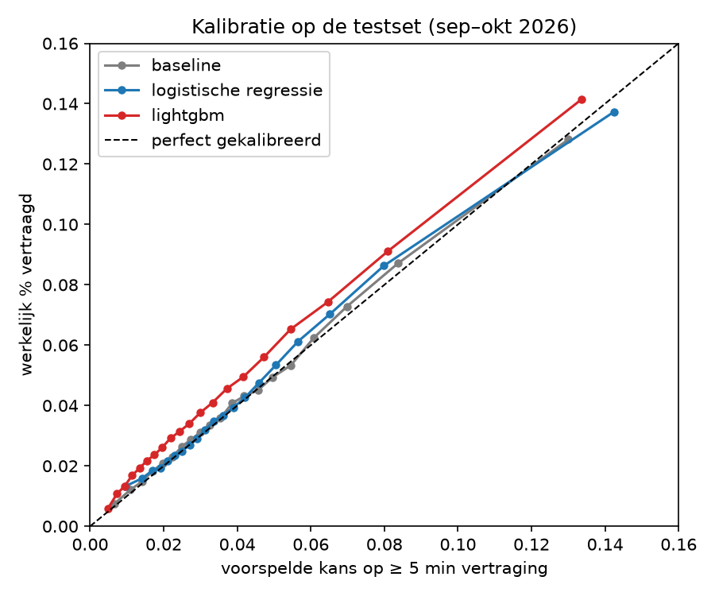
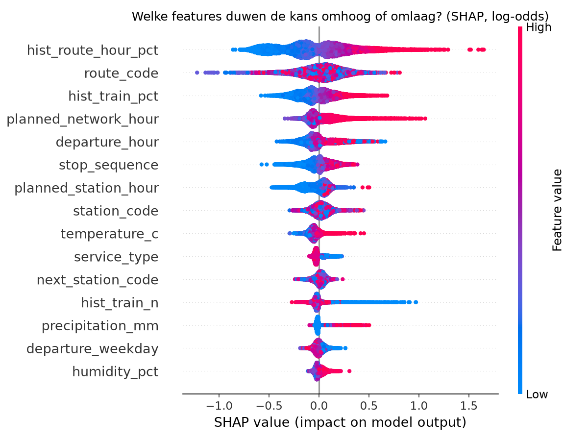
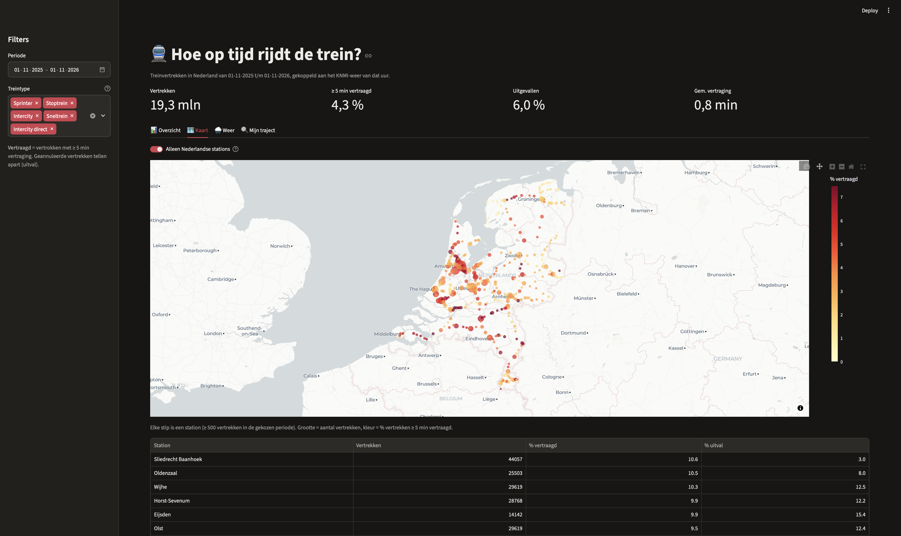
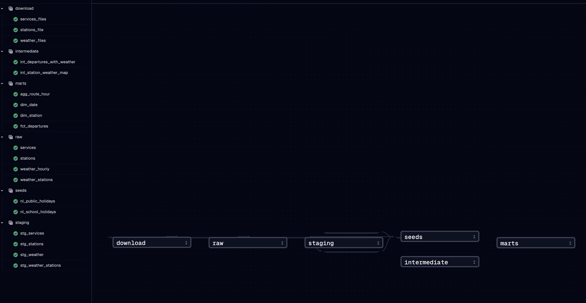

# OV-vertragingsvoorspeller

[](https://github.com/jadendeleij/ov-vertraging/actions/workflows/ci.yml)

Voorspelt de kans dat een trein in Nederland ≥ 5 minuten vertraging heeft bij vertrek, op basis van historische treindata en het weer.

**🌐 Probeer het live:** [ov-vertraging-app.onrender.com](https://ov-vertraging-app.onrender.com) (dashboard) · [API-documentatie](https://ov-vertraging-api.onrender.com/docs)

> Gratis hosting: na 15 minuten zonder bezoek slaapt de app; het eerste bezoek duurt dan ~1 minuut.

## Roadmap

- [x] Fase 1 – Data binnenhalen (treinarchief + stations → DuckDB, kwaliteitschecks)
- [x] Fase 2 – Datapipeline (KNMI-weer, dbt, Dagster)
- [x] Fase 3 – Analyse & dashboard
- [x] Fase 4 – Model (LightGBM)
- [x] Fase 5 – Live API + web-app, Docker, CI en monitoring
- [ ] Fase 6 – Presenteren

## Top 3 inzichten

Uit 17,2 mln binnenlandse treinvertrekken (nov 2025 – okt 2026), zie [het verkenningsnotebook](notebooks/01_verkenning.ipynb):

1. **Sneeuw verdubbelt de kans op vertraging** (9,4 % tegen 4,1 % normaal). Ook vorst, hevige regen, hitte (≥ 30 °C) en windstoten ≥ 9 Bft geven elk ~1,5–2 procentpunt extra; *gemiddelde* wind maakt nauwelijks uit. Temperatuur werkt als een U: kou én hitte zijn slecht.
2. **Vertraging stapelt zich op, over de dag en over het jaar.** De avondspits (18 uur: 5,4 %) is ruim twee keer zo slecht als de vroege ochtend (5 uur: 2,5 %); november (6,2 %) en januari (5,4 %) zijn de slechtste maanden. Een Intercity is vaker te laat dan een Sprinter (6,1 % tegen 3,6 %).
3. **Kleine vertragingen lopen meestal in.** Van de treinen met 3 minuten vertraging haalt maar 2,3 % later in de rit 10 minuten, en ruim een derde loopt in. Pas boven ~6 minuten loopt het uit de hand (bij 9 minuten: 42 %).

De slechtste dagen kwamen door sneeuw en bevroren wissels (5–7 januari 2026), koperdiefstal en defecte treinen (17–18 november 2025) en een landelijke OV-staking (9 september 2026: 92 % uitval) — gebeurtenissen die geen model vooraf ziet aankomen.

## Model

Voorspelt per vertrek de kans op ≥ 5 min vertraging, een paar uur vóór vertrek, met alleen informatie die dan bekend is (dienstregeling, kalender, weer, geschiedenis t/m gisteren). Getest op september–oktober 2026, maanden die het model nooit zag. Volledige uitleg, leakage-regels en foutanalyse: [`docs/model.md`](docs/model.md).

| Model (testset, 2,9 mln vertrekken) | PR-AUC ↑ | ROC-AUC ↑ | Brier ↓ |
|---|---|---|---|
| Willekeurig gokken | 0,042 | 0,500 | — |
| Baseline: historisch % per traject × uur | 0,092 | 0,683 | 0,0391 |
| Logistische regressie | 0,100 | 0,678 | 0,0390 |
| **LightGBM** | **0,107** | **0,701** | **0,0389** |

- LightGBM vindt vertragingen **2,5× zo goed als gokken**: de 10 % vertrekken met de hoogste voorspelde kans bevatten 28 % van alle vertragingen.
- Belangrijkste drijfveren (SHAP): de geschiedenis van traject × uur, drukte op het spoor, het uur en de plek in de rit; daarna het weer.
- Eerlijk: storingen, stormen en de nasleep van een staking zijn vooraf niet te zien; daar zit het model er het meest naast.

<p>
  
  
</p>

Trainen (≈ 20 min, 8 GB RAM is genoeg): `python -m ov_vertraging.model.train`

## Live API en web-app

**Online:** [dashboard](https://ov-vertraging-app.onrender.com) en [API](https://ov-vertraging-api.onrender.com/docs) op Render (gratis plan, Frankfurt), gedeployd via [`render.yaml`](render.yaml) bij elke push naar `main`.

Het model draait achter een **FastAPI** ([`api/main.py`](api/main.py)) op een slanke export van 8 MB ([`serving/export.py`](src/ov_vertraging/serving/export.py)) in plaats van de database van 3 GB:

| Endpoint | Wat het doet |
|---|---|
| `POST /predict` | Van-station, naar-station en vertrektijd → de eerste directe trein, de kans op ≥ 5 min vertraging, risiconiveau, de 3 belangrijkste factoren in gewone taal en de weersverwachting |
| `GET /departures/{station}` | Live vertrekken van de **NS**, met per trein de voorspelde kans (en de actuele vertraging volgens NS ter vergelijking) |
| `GET /stations`, `GET /health` | Stationslijst en status |

- **Weersverwachting:** het KNMI-model HARMONIE via [Open-Meteo](https://open-meteo.com/en/docs/knmi-api), omgezet naar dezelfde features als in de training.
- **Uitleg:** per voorspelling de SHAP-bijdragen van LightGBM, bv. *"dit traject op dit uur was eerder 7 % van de keren vertraagd — verhoogt de kans"*.
- Het Streamlit-dashboard heeft de tabbladen **Voorspel mijn reis** en **Live vertrekken**, die de API aanroepen. Zonder database (online) toont het alleen die twee.

```bash
python -m ov_vertraging.serving.export      # maakt models/serving (na het trainen)
uvicorn api.main:app                        # http://localhost:8000/docs
streamlit run app/dashboard.py              # http://localhost:8501
```

Voor `/departures` is een gratis NS-key nodig (apiportal.ns.nl, product "Ns-App") in `.env`; zie [`.env.example`](.env.example).

### Docker

```bash
docker compose up --build                   # API op :8000, dashboard op :8501
```

Twee slanke images ([`api/Dockerfile`](api/Dockerfile), [`app/Dockerfile`](app/Dockerfile)): Python 3.12-slim, alleen de benodigde dependencies (de API-image bevat geen dbt, Dagster of MLflow), draaien niet als root, met healthchecks.

### Monitoring

Werkt het model nog op dagen die het nooit zag? Elke dag scoort Dagster de nieuwe dagen met het opgeslagen model ([`monitoring.py`](src/ov_vertraging/monitoring.py), incrementeel: elke dag precies één keer) en zet per dag *voorspeld vs. werkelijk %*, PR-AUC, ROC-AUC en Brier in `monitoring.daily`. Het dashboard toont dat in het tabblad **📈 Monitoring**; een Dagster-check waarschuwt als de verhouding voorspeld ÷ werkelijk over 30 dagen buiten 0,67–1,5 valt.

Eerste uitkomst (model getraind t/m augustus):

| Maand | Werkelijk vertraagd | Gemiddeld voorspeld | PR-AUC |
|---|---|---|---|
| september 2026 | 3,67 % | 3,58 % | 0,10 |
| oktober 2026 | 4,65 % | 3,37 % | 0,12 |

In september klopt het model goed; in oktober onderschat het met ~28 %: het mist het herfsteffect dat het in de trainingsdata (t/m augustus) niet zag. Dat is precies *model drift* — het signaal om het model maandelijks opnieuw te trainen. Beperking: de echte uitkomsten komen per maand binnen, dus de monitoring loopt tot ~1 maand achter.

### CI

[GitHub Actions](.github/workflows/ci.yml) draait bij elke push: ruff, pytest, de **volledige pipeline + `dbt build` op een meegeleverde voorbeelddataset** ([`tests/fixtures/sample`](tests/fixtures/sample), 627 KB echte data, gemaakt met `python -m ov_vertraging.sample`) en het bouwen + starten van beide Docker-images.

## Architectuur

```
Bronnen                     raw (Python)            dbt                                   Gebruik
Rijden de Treinen ──┐
  treinarchief      ├──► data/raw/ ──► DuckDB raw.* ──► staging ──► intermediate ──► marts ──► dashboard / model
  stations          │                  + 14 checks      (views)     (koppelingen)    (tabellen)
KNMI uurweer ───────┘
Feestdagen + schoolvakanties ─────────────────────────► seeds ──────┘
                         Dagster draait dit elke dag om 07:00 · 70 asset checks + 110 tests
```

## Zelf draaien

Vereist Python 3.11–3.13 (dagster-dbt ondersteunt 3.14 nog niet). macOS / Linux:

```bash
python3.12 -m venv .venv
source .venv/bin/activate
pip install -e ".[dev]"        # alles; of alleen .[api], .[app], .[pipeline], .[model]
pytest
```

Daarna de pipeline, óf met losse commando's:

```bash
python -m ov_vertraging.download --start 2025-11 --end 2026-10 --stations
python -m ov_vertraging.download_weather --start 2025-11 --end 2026-10
python -m ov_vertraging.load
cd transform && dbt build && dbt docs generate
```

óf in één keer via Dagster (zie hieronder):

```bash
dagster dev
```

Windows (PowerShell): gelijk, maar activeer met `.venv\Scripts\Activate.ps1` en gebruik `py -3.12` i.p.v. `python3.12`.

`dbt docs serve` (in `transform/`) opent de dbt-documentatie met de lineage-grafiek in je browser.

Dashboard en notebook (na het draaien van de pipeline):

```bash
streamlit run app/dashboard.py
jupyter notebook notebooks/01_verkenning.ipynb
```

## Dashboard (Streamlit)

[`app/dashboard.py`](app/dashboard.py) laat iedereen de data verkennen zonder SQL. Filters op periode en treintype; vier tabbladen:



| Tabblad | Wat je ziet |
|---|---|
| 📊 Overzicht | KPI's (vertrekken, % ≥ 5 min vertraagd, % uitval, gem. vertraging), heatmap uur × weekdag, verloop per dag |
| 🗺️ Kaart | Elk station als stip op de kaart, gekleurd op punctualiteit, plus de 15 minst stipte stations |
| 🌧️ Weer | % vertraagd per weertype en de temperatuurcurve |
| 🔍 Mijn traject | Kies twee stations: hoe vaak kwamen directe treinen ≥ 5 min te laat aan, en op welk uur het best? |

Alle SQL staat in [`dashboard_queries.py`](src/ov_vertraging/dashboard_queries.py) (geparametriseerd, getest op een klein nepschema); het dashboard leest read-only uit de marts en doet de zware aggregaties in DuckDB.

## Orkestratie (Dagster)

[`orchestration/definitions.py`](orchestration/definitions.py) beschrijft de hele pipeline als **assets**: dingen die bestaan en ververst kunnen worden (een bestand, een tabel), met hun afhankelijkheden. Dagster leidt daaruit de volgorde af en toont de lineage.



| Groep | Assets | Wat er gebeurt |
|---|---|---|
| `download` | `services_files`, `stations_file`, `weather_files` | Nieuwe maanden ophalen. Standaard de vorige en de huidige maand; een maand die nog niet gepubliceerd is (HTTP 404) wordt overgeslagen. |
| `raw` | `raw/services`, `raw/stations`, `raw/weather_hourly`, `raw/weather_stations` | Laden in DuckDB. De 14 kwaliteitschecks zijn **blocking asset checks**: faalt er één, dan draait dbt niet op kapotte data. |
| `seeds`, `staging`, `intermediate`, `marts` | 12 dbt-assets | Via `dagster-dbt`: elk dbt-model is een asset, elke dbt-test een asset check. |
| `model` | `ml_features`, `model_predictions`, `model_monitoring` | Features bijwerken, het opgeslagen model laten voorspellen op nieuwe dagen, en per dag vergelijken met de werkelijkheid (zie Monitoring). |

- **Job** `dagelijkse_pipeline`: alles, in de juiste volgorde (~1 minuut).
- **Schema** `dagelijks_07u`: elke dag om 07:00 (Europe/Amsterdam), staat standaard aan.
- Starten: `dagster dev` in de projectroot en open http://localhost:3000. Zet `DAGSTER_HOME` op een vaste map (bv. `export DAGSTER_HOME=$PWD/.dagster_home`) om de run-historie te bewaren. Het schema draait alleen zolang `dagster dev` draait; echt 24/7 draaien komt in fase 5 (hosting).
- Eén keer alles draaien zonder UI: `dagster job execute -f orchestration/definitions.py -j dagelijkse_pipeline`.

## Waarom drie lagen?

| Laag | Vraag die de laag beantwoordt | Regel |
|---|---|---|
| **raw** | *Wat leverde de bron precies?* | Niets aanpassen, alleen nette kolomnamen en types. Zo kun je altijd terug naar het origineel. |
| **staging** | *Wat betekent elke waarde?* | Opschonen per bron: eenheden (0,1 °C → °C), tijdzones, datafouten markeren. Nog geen koppelingen. |
| **intermediate** | *Hoe hangen de bronnen samen?* | Zware koppelingen op één plek: trein → weerstation, vertrek → weer van dat uur, stop → volgend station. |
| **marts** | *Wat heeft de gebruiker nodig?* | Eén tabel per doel: feiten (`fct_departures`), context (`dim_*`), samenvattingen (`agg_*`). |

Waarom niet alles in één grote query? Elke laag heeft één verantwoordelijkheid. Klopt een cijfer in het dashboard niet, dan zie je in de lineage precies waar je moet zoeken. Een fix in staging (bv. de 24-uur-datumfout) werkt automatisch door naar alles erna. En elke laag heeft zijn eigen tests: staging test bronwaarden, marts testen de bedrijfsregels (zoals de targetdefinitie).

## Wat betekent idempotent in deze pipeline?

**Idempotent = een stap twee keer draaien geeft hetzelfde resultaat als één keer.** Daardoor kan het schema elke dag gewoon alles draaien, en kun je na een fout zonder nadenken opnieuw starten.

| Stap | Hoe het idempotent is |
|---|---|
| Download treinen/stations | Bestaat het bestand al, dan wordt het overgeslagen. Downloaden gaat via een `.part`-bestand, zodat een afgebroken download nooit als compleet geldt. |
| Download weer | Een maand wordt ververst tot hij ≥ 3 dagen na afloop is opgehaald (KNMI loopt ~2 dagen achter); daarna overgeslagen. |
| Laden | `CREATE OR REPLACE TABLE`: de raw-tabel wordt elke keer volledig opnieuw opgebouwd uit alle bestanden, dus nooit dubbele rijen. |
| dbt | Elk model is een `CREATE OR REPLACE` van een view of tabel, berekend uit de laag eronder. |
| Seeds | Vaste CSV's in git; opnieuw laden geeft dezelfde tabel. |

Getest: twee keer laden geeft hetzelfde aantal rijen (`test_load_is_idempotent`), en een download van een bestaand bestand doet geen netwerkverzoek.

## Transformaties (dbt)

Het dbt-project staat in [`transform/`](transform/) en schrijft naar dezelfde DuckDB-database, in de schema's `staging`, `intermediate` en `marts`, naast `raw`.

**Staging** (views, één-op-één met de bron, opgeschoond):

| Model | Wat het doet |
|---|---|
| `stg_services` | Tijden naar Nederlandse tijd én UTC-uur, afgeleide velden `departure_hour` en `departure_weekday`, onmogelijke vertragingen (> 600 min) naar NULL met vlag, `is_rail_service` (vervangende bussen en metro eruit te filteren). `service_max_delay_min` bewust weggelaten (leakage). |
| `stg_stations` | Treinstations met nette namen, land en coördinaten. |
| `stg_weather` | KNMI-codes naar °C, mm, m/s, Beaufort en meters zicht; begin van het uurvak in UTC en lokale tijd. |
| `stg_weather_stations` | Weerstations met coördinaten en welke variabelen ze echt meten (34 van 51 meten temperatuur). |

**Intermediate** (koppelingen):

| Model | Wat het doet |
|---|---|
| `int_station_weather_map` | Elk treinstation → per variabele (temperatuur, neerslag, wind, zicht) het dichtstbijzijnde KNMI-station dat die variabele echt meet, via de haversine-afstand. Gemiddeld 14 km, maximaal 36 km voor Nederlandse stations; > 50 km = geen weer. |
| `int_departures_with_weather` | (view) 19,6 mln treinvertrekken met volgend station (`route_code`, 2.979 trajecten) en het weer van dat uur; 97,5 % heeft een temperatuur. Volgorde van stops op geplande tijd, niet op `stop_id`: bij omleidingen krijgt een extra stop een later id. Een view en geen tabel, zodat de 19,6 mln rijen niet twee keer op schijf staan. |

**Marts** (tabellen voor dashboard en model):

| Model | Wat het doet |
|---|---|
| `fct_departures` | Eén rij per treinvertrek met target `is_delayed_5min`, tijd, traject en weer (+ vlaggen `is_frost`, `is_wind_7bft`, `is_heavy_rain`). |
| `dim_station` | 645 stations: het stationsbestand plus 54 stations uit het treinarchief die er niet in staan (vooral buitenland), met gekoppelde weerstations. |
| `dim_date` | 366 dagen met weekdag, seizoen, feestdagen en schoolvakanties per regio (noord/midden/zuid). |
| `agg_route_hour` | Punctualiteit per traject × uur × weekdag (205.621 rijen): % ≥ 5 min, % geannuleerd, gemiddelde en p90-vertraging. |

**Target `is_delayed_5min`**: `true` = vertrokken met ≥ 5 min vertraging, `false` = < 5 min, `NULL` = geannuleerd of vertraging onbekend. Het model voorspelt dus *"als de trein rijdt, wat is de kans op ≥ 5 min vertraging?"*; annuleringen (6,0 % van de vertrekken) zijn een apart cijfer, zoals NS dat ook rapporteert. Van de 18,45 mln vertrekken met een target is 4,64 % vertraagd.

**Seeds**: feestdagen (berekend, Pasen via het Meeus-algoritme) en schoolvakanties (open data Rijksoverheid) staan als kleine CSV's in [`transform/seeds/`](transform/seeds/), gemaakt met `python -m ov_vertraging.calendar_seeds --years 2025 2026`. Zo draait `dbt build` zonder internet.

**Waarom koppelen op UTC?** Bij de overgang naar wintertijd (25 oktober 2026) komt lokaal 02:00 twee keer voor. Een koppeling op Nederlandse tijd zou dan elk vertrek aan twee weeruren hangen. In UTC is elk uur uniek. Een eigen dbt-test ([`assert_weather_dst_switch`](transform/tests/assert_weather_dst_switch.sql)) bewaakt dit.

**Tests**: 77 in totaal (`dbt build` ~20 s): `unique`/`not_null` op sleutels, `accepted_values` op treintype en regio, `relationships` tussen `fct_departures` en de dimensies, en eigen tests: [`value_between`](transform/tests/generic/value_between.sql) (bv. vertraging tussen −5 en 600 min), [`unique_combination`](transform/tests/generic/unique_combination.sql) (station × uur), twee tijdzonetests, een weerdekkingstest (≥ 95 % van de NL-vertrekken heeft weer), een test op de exacte targetdefinitie en een steekproef van bekende dagen in `dim_date`.

## Data

Treinarchief van Rijden de Treinen, november 2025 t/m oktober 2026 (12 maanden):

| | |
|---|---|
| Ruwe bestanden | 12 × ~33 MB gzip-CSV = 383 MB |
| Rijen in `raw.services` | 22.521.886 stops van 2.397.288 ritten |
| Downloadtijd | ~13 s |
| Laadtijd in DuckDB (incl. kwaliteitschecks) | ~11 s, piekgeheugen ~1,6 GB |
| Grootte `data/ov.duckdb` | 498 MB na eerste keer laden; stabiel ~920 MB bij herladen (zie hieronder) |
| Vertrekken ≥ 5 min vertraagd | 4,3 % (hoogst in nov 2025: 6,0 %, laagst in jul 2026: 3,4 %) |
| Stations in `raw.stations` | 591 (397 NL, 194 buitenland), met coördinaten en stationstype |
| Weer in `raw.weather_hourly` | 402.960 uurrijen = 46 weerstations × 8.760 uur, geen enkel uur ontbrekend (42 MB ruw, ~15 s download) |

Gemeten op een Mac met Apple Silicon. DuckDB leest de gzip-bestanden rechtstreeks; er gaan geen ruwe rijen door pandas.

Over de bestandsgrootte: `CREATE OR REPLACE` maakt de oude tabel vrij, maar DuckDB geeft die ruimte niet terug aan het besturingssysteem. Bij de volgende run worden die vrije blokken hergebruikt, dus het bestand stabiliseert rond 2× de data en groeit niet onbeperkt.

### Weerbron: waarom KNMI-uurgegevens

We gebruiken de [KNMI-uurgegevensdienst](https://www.daggegevens.knmi.nl/klimatologie/uurgegevens): gevalideerde uurwaarden van alle automatische weerstations.

| | KNMI-uurgegevens (gekozen) | KNMI Data Platform (hourly validated) |
|---|---|---|
| API-key | niet nodig | nodig |
| Formaat | CSV, één request per maand voor alle stations | NetCDF-bestanden |
| Stationscoördinaten | in de kop van het bestand | in de NetCDF-bestanden |
| Actualiteit | ~2 dagen vertraging | ~1–2 dagen vertraging |

De meetwaarden zijn dezelfde. De uurgegevensdienst is eenvoudiger en vereist geen secrets, wat ook CI makkelijker maakt. Risico: het is een oudere dienst. Als KNMI die uitzet, hoeft alleen [`download_weather.py`](src/ov_vertraging/download_weather.py) om naar het Data Platform.

Variabelen per uur (in `raw` in bron-eenheden, omrekenen gebeurt in dbt staging): temperatuur, neerslag, gemiddelde wind, windstoten, windrichting, zicht, luchtvochtigheid, bewolking, zonneschijn, en vlaggen voor mist, sneeuw, onweer en ijsvorming.

Valkuilen in deze bron, afgevangen in code en tests:
- Uren lopen van 1 t/m 24 in **UTC**: uur 5 = 04:00–05:00 UTC. Treintijden zijn Nederlandse tijd, dus de koppeling moet omrekenen (zomer-/wintertijd!).
- Veel waarden zijn in **tienden** (0,1 °C, 0,1 mm, 0,1 m/s); neerslag `-1` betekent < 0,05 mm (droog).
- Met een einde op uur 24 levert KNMI ook de **volgende dag** mee; de loader filtert per bestand op de eigen maand.
- Niet elk station meet alles: ~26 % van de uren heeft geen temperatuur (zee- en windstations). De koppeling trein → weerstation moet per variabele een station kiezen dat die variabele meet.
- De weercode (`WW`) levert deze dienst voor geen enkel station; die is daarom niet opgenomen.

Het stationsbestand (`stations-2023-09.csv`) is de nieuwste versie van Rijden de Treinen. We gebruiken de variant mét buitenlandse stations, omdat het treinarchief ook ritten naar Duitsland en België bevat. 99,8 % van alle stops koppelt aan een station; de rest zijn metrohaltes bij vervangend vervoer en enkele buitenlandse stations.

### Datakwaliteit

Bij elke laadronde draait [`quality.py`](src/ov_vertraging/quality.py). Faalt er één check, dan stopt de pipeline.
- `raw.services`: rijen > 0, `stop_id` uniek, sleutelkolommen niet NULL, elke rit ≥ 2 stops, vertraging binnen [−5, 600] min (max 0,1 % uitschieters).
- `raw.stations`: rijen > 0, `station_code` uniek, coördinaten binnen Europa, ≥ 99 % van de stops heeft een bekend station.
- `raw.weather_*`: rijen > 0, (station, datum, uur) uniek, uur tussen 1 en 24, temperatuur en windstoten plausibel, elk weerstation heeft coördinaten.

Bekende eigenaardigheden van de bron:
- Een handvol DB-treinen (Duitsland) heeft precies ~1440 min vertraging: een datumfout van 24 uur. Dat is 0,007 % van de rijen; ze worden in de staging-laag weggefilterd.
- Te vroeg vertrekken wordt als 0 min opgeslagen (geen negatieve vertragingen).
- `Service:Maximum delay` staat alleen op de eerste stop van een rit ingevuld.
- De data bevat ook vervangende bussen (`... ipv trein`) en internationale treinen.

## Bronnen

- Treindata: [Rijden de Treinen – treinarchief](https://www.rijdendetreinen.nl/open-data/treinarchief), licentie [CC BY 4.0](https://creativecommons.org/licenses/by/4.0/).
- Stations: [Rijden de Treinen – stations](https://www.rijdendetreinen.nl/open-data/stations), licentie [CC BY 4.0](https://creativecommons.org/licenses/by/4.0/).
- Weer: [KNMI – uurgegevens van het weer in Nederland](https://www.knmi.nl/nederland-nu/klimatologie/uurgegevens), bron: Koninklijk Nederlands Meteorologisch Instituut (KNMI).

## Licentie

De code valt onder de [MIT-licentie](LICENSE). De data valt onder de licenties van de bronnen hierboven.
