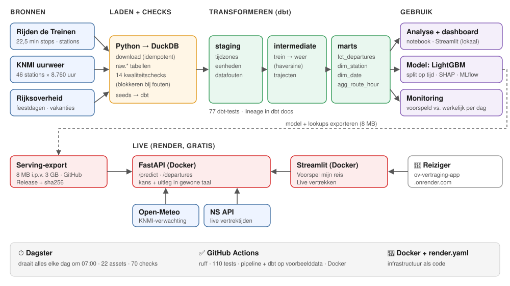

# OV-vertragingsvoorspeller

[](https://github.com/jadendeleij/ov-vertraging/actions/workflows/ci.yml)


**Komt mijn trein op tijd?** Een end-to-end data- en ML-project dat met een jaar Nederlandse treindata (22,5 mln stops) en het KNMI-weer voorspelt hoe groot de kans is dat een trein ≥ 5 minuten te laat vertrekt — van ruwe bestanden tot een live web-app.

**🌐 Probeer het live:** [ov-vertraging-app.onrender.com](https://ov-vertraging-app.onrender.com) · [API-documentatie](https://ov-vertraging-api.onrender.com/docs)
<sub>Gratis hosting: na 15 minuten zonder bezoek slaapt de app; het eerste bezoek duurt dan ~1 minuut.</sub>


## Wat het doet

- **Datapipeline** — downloadt treinarchief, stations en uurweer, laadt alles in DuckDB met 14 kwaliteitschecks, transformeert met dbt (77 tests) en draait dagelijks via Dagster.
- **Analyse** — een [notebook](notebooks/01_verkenning.ipynb) en een Streamlit-dashboard met kaart, heatmap, weereffecten en stiptheid per traject.
- **Model** — LightGBM, eerlijk getest op maanden die het nooit zag, met uitleg per voorspelling (SHAP).
- **Live** — FastAPI + Streamlit in Docker op Render: voorspel je reis met de KNMI-weersverwachting, of bekijk live NS-vertrekken met per trein de kans.
- **Productierijp** — CI op elke push, slanke images, monitoring die laat zien wanneer het model opnieuw getraind moet worden.

## Architectuur



## In cijfers

| | |
|---|---|
| Data | **22,5 mln** treinstops (2,4 mln ritten, nov 2025 – okt 2026) · **402.960** uur KNMI-weer · 591 stations |
| Kwaliteit | **14** datakwaliteitschecks · **77** dbt-tests · **110** pytest-tests · **70** Dagster asset checks |
| Model | vindt vertragingen **2,5×** zo goed als gokken; de 10 % riskantste vertrekken bevatten **28 %** van alle vertragingen |
| Live | export van **8 MB** in plaats van een database van 3 GB · API ~180 MB geheugen · CI in ~1,5 min |

## Top 3 inzichten

Uit 17,2 mln binnenlandse treinvertrekken ([notebook](notebooks/01_verkenning.ipynb)):

1. **Sneeuw verdubbelt de kans op vertraging** (9,4 % tegen 4,1 % normaal). Ook vorst, hevige regen, hitte (≥ 30 °C) en windstoten ≥ 9 Bft geven elk ~1,5–2 procentpunt extra; *gemiddelde* wind maakt nauwelijks uit.
2. **Vertraging stapelt zich op, over de dag en over het jaar.** De avondspits (18 uur: 5,4 %) is ruim twee keer zo slecht als de vroege ochtend (5 uur: 2,5 %); november en januari zijn de slechtste maanden. Een Intercity is vaker te laat dan een Sprinter (6,1 % tegen 3,6 %).
3. **Kleine vertragingen lopen meestal in.** Van de treinen met 3 minuten vertraging haalt maar 2,3 % later in de rit 10 minuten; pas boven ~6 minuten loopt het uit de hand.

De slechtste dagen kwamen door sneeuw en bevroren wissels (januari 2026), koperdiefstal (november 2025) en een landelijke OV-staking (9 september 2026: 92 % uitval) — gebeurtenissen die geen model vooraf ziet aankomen.

## Model

Voorspelt per vertrek de kans op ≥ 5 min vertraging, een paar uur vóór vertrek, met alleen informatie die dan bekend is. Getest op september–oktober 2026; een test bewaakt dat er geen toekomstinformatie lekt. Volledige uitleg: [`docs/model.md`](docs/model.md).

| Model (testset, 2,9 mln vertrekken) | PR-AUC ↑ | ROC-AUC ↑ |
|---|---|---|
| Willekeurig gokken | 0,042 | 0,500 |
| Baseline: historisch % per traject × uur | 0,092 | 0,683 |
| Logistische regressie | 0,100 | 0,678 |
| **LightGBM** | **0,107** | **0,701** |

<p>
  
  
</p>

**Eerlijk:** de winst op de simpele baseline is bescheiden — het meeste wat voorspelbaar is, zit al in "dit traject op dit uur was vaker te laat". Storingen en stormen zie je vooraf niet. En de [monitoring](docs/live.md#monitoring) liet zien dat het model in oktober ~28 % te laag voorspelde: het mist het herfsteffect, een signaal om maandelijks opnieuw te trainen.

## Techstack

| Onderdeel | Gebruikt |
|---|---|
| Opslag | DuckDB (één bestand, SQL op 22 mln rijen in seconden) |
| Transformaties | dbt-core + dbt-duckdb: staging → intermediate → marts, seeds, eigen tests |
| Orkestratie | Dagster + dagster-dbt: 22 assets, dagelijks schema, blokkerende asset checks |
| Analyse | Jupyter, pandas, matplotlib, Streamlit, Plotly |
| Model | LightGBM, scikit-learn, SHAP, MLflow |
| Live | FastAPI, Open-Meteo (KNMI-verwachting), NS Reisinformatie API |
| Kwaliteit & deploy | pytest, ruff, GitHub Actions, Docker, Render (Blueprint) |

## Zelf draaien

Python 3.11–3.13. macOS / Linux (Windows: activeer met `.venv\Scripts\Activate.ps1`, gebruik `py -3.12`):

```bash
python3.12 -m venv .venv && source .venv/bin/activate
pip install -e ".[dev]"
pytest
```

Pipeline (download ~30 s, laden ~15 s, dbt ~20 s), of alles in één keer met `dagster dev`:

```bash
python -m ov_vertraging.download --start 2025-11 --end 2026-10 --stations
python -m ov_vertraging.download_weather --start 2025-11 --end 2026-10
python -m ov_vertraging.load
cd transform && dbt build && cd ..
```

Model, live app en dashboard:

```bash
python -m ov_vertraging.model.train                # ~20 min op 8 GB RAM
python -m ov_vertraging.serving.export             # slanke export voor de API
uvicorn api.main:app                               # http://localhost:8000/docs
streamlit run app/dashboard.py                     # http://localhost:8501
docker compose up --build                          # of beide in containers
```

Voor live NS-vertrekken: gratis key van [apiportal.ns.nl](https://apiportal.ns.nl) in `.env` (zie [`.env.example`](.env.example)).

## Verder lezen

- [`docs/pipeline.md`](docs/pipeline.md) — Dagster, waarom drie dbt-lagen, idempotentie, alle modellen, de data en hun valkuilen
- [`docs/model.md`](docs/model.md) — probleemdefinitie, features, leakage, resultaten, foutanalyse
- [`docs/live.md`](docs/live.md) — API, dashboard, Docker, CI en monitoring
- [`notebooks/01_verkenning.ipynb`](notebooks/01_verkenning.ipynb) — de analyse met grafieken

**Hoe het gebouwd is:** in zes fasen, elk via een pull request met uitleg en bevindingen: [data binnenhalen](https://github.com/jadendeleij/ov-vertraging/commits/main) · [pipeline](https://github.com/jadendeleij/ov-vertraging/pull/1) · [analyse & dashboard](https://github.com/jadendeleij/ov-vertraging/pull/2) · [model](https://github.com/jadendeleij/ov-vertraging/pull/3) · [live](https://github.com/jadendeleij/ov-vertraging/pull/4) · [monitoring](https://github.com/jadendeleij/ov-vertraging/pull/6).

## Bronnen

- Treindata en stations: [Rijden de Treinen](https://www.rijdendetreinen.nl/open-data), licentie [CC BY 4.0](https://creativecommons.org/licenses/by/4.0/).
- Weer: [KNMI – uurgegevens](https://www.knmi.nl/nederland-nu/klimatologie/uurgegevens); verwachting via [Open-Meteo](https://open-meteo.com) (KNMI HARMONIE-model).
- Live vertrektijden: [NS Reisinformatie API](https://apiportal.ns.nl).
- Feestdagen en schoolvakanties: [Rijksoverheid open data](https://opendata.rijksoverheid.nl).

## Licentie

De code valt onder de [MIT-licentie](LICENSE). De data valt onder de licenties van de bronnen hierboven.
