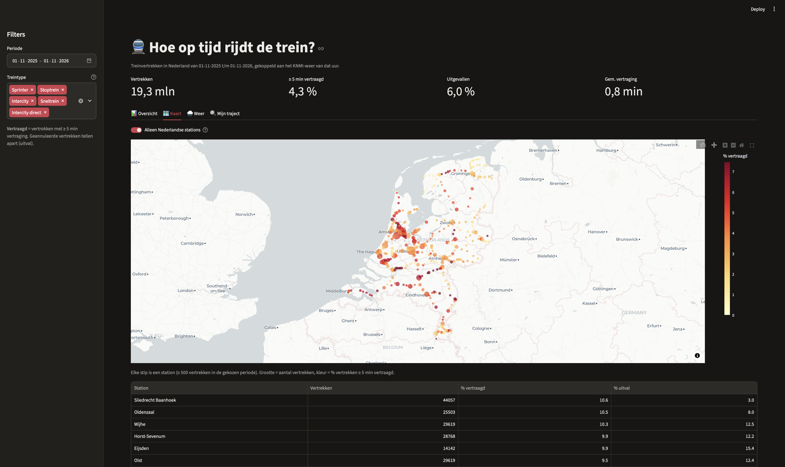

# Live app in detail: API, dashboard, Docker, CI en monitoring

Terug naar de [README](../README.md).

## Live API en web-app

**Online:** [dashboard](https://ov-vertraging-app.onrender.com) en [API](https://ov-vertraging-api.onrender.com/docs) op Render (gratis plan, Frankfurt), gedeployd via [`render.yaml`](../render.yaml) bij elke push naar `main`.

Het model draait achter een **FastAPI** ([`api/main.py`](../api/main.py)) op een slanke export van 8 MB ([`serving/export.py`](../src/ov_vertraging/serving/export.py)) in plaats van de database van 3 GB:

| Endpoint | Wat het doet |
|---|---|
| `POST /predict` | Van-station, naar-station en vertrektijd → de eerste directe trein, de kans op ≥ 5 min vertraging, risiconiveau, de 3 belangrijkste factoren in gewone taal en de weersverwachting |
| `GET /departures/{station}` | Live vertrekken van de **NS**, met per trein de voorspelde kans (en de actuele vertraging volgens NS ter vergelijking) |
| `GET /stations`, `GET /health` | Stationslijst en status |

- **Weersverwachting:** het KNMI-model HARMONIE via [Open-Meteo](https://open-meteo.com/en/docs/knmi-api), omgezet naar dezelfde features als in de training.
- **Uitleg:** per voorspelling de SHAP-bijdragen van LightGBM, bv. *"dit traject op dit uur was eerder 7 % van de keren vertraagd — verhoogt de kans"*.
- Het Streamlit-dashboard heeft de tabbladen **Voorspel mijn reis** en **Live vertrekken**, die de API aanroepen. Zonder database (online) toont het alleen die twee.

```bash
python -m ov_vertraging.serving.export      # maakt models/serving (na het trainen)
uvicorn api.main:app                        # http://localhost:8000/docs
streamlit run app/dashboard.py              # http://localhost:8501
```

Voor `/departures` is een gratis NS-key nodig (apiportal.ns.nl, product "Ns-App") in `.env`; zie [`.env.example`](../.env.example).

## Docker

```bash
docker compose up --build                   # API op :8000, dashboard op :8501
```

Twee slanke images ([`api/Dockerfile`](../api/Dockerfile), [`app/Dockerfile`](../app/Dockerfile)): Python 3.12-slim, alleen de benodigde dependencies (de API-image bevat geen dbt, Dagster of MLflow), draaien niet als root, met healthchecks.

## Monitoring

Werkt het model nog op dagen die het nooit zag? Elke dag scoort Dagster de nieuwe dagen met het opgeslagen model ([`monitoring.py`](../src/ov_vertraging/monitoring.py), incrementeel: elke dag precies één keer) en zet per dag *voorspeld vs. werkelijk %*, PR-AUC, ROC-AUC en Brier in `monitoring.daily`. Het dashboard toont dat in het tabblad **📈 Monitoring**; een Dagster-check waarschuwt als de verhouding voorspeld ÷ werkelijk over 30 dagen buiten 0,67–1,5 valt.

Eerste uitkomst (model getraind t/m augustus):

| Maand | Werkelijk vertraagd | Gemiddeld voorspeld | PR-AUC |
|---|---|---|---|
| september 2026 | 3,67 % | 3,58 % | 0,10 |
| oktober 2026 | 4,65 % | 3,37 % | 0,12 |

In september klopt het model goed; in oktober onderschat het met ~28 %: het mist het herfsteffect dat het in de trainingsdata (t/m augustus) niet zag. Dat is precies *model drift* — het signaal om het model maandelijks opnieuw te trainen. Beperking: de echte uitkomsten komen per maand binnen, dus de monitoring loopt tot ~1 maand achter.

## CI

[GitHub Actions](../.github/workflows/ci.yml) draait bij elke push: ruff, pytest, de **volledige pipeline + `dbt build` op een meegeleverde voorbeelddataset** ([`tests/fixtures/sample`](../tests/fixtures/sample), 627 KB echte data, gemaakt met `python -m ov_vertraging.sample`) en het bouwen + starten van beide Docker-images.

## Dashboard (Streamlit)

[`app/dashboard.py`](../app/dashboard.py) laat iedereen de data verkennen zonder SQL. Filters op periode en treintype. Lokaal (met de database) zijn er zeven tabbladen; online alleen *Voorspel mijn reis* en *Live vertrekken*:



| Tabblad | Wat je ziet |
|---|---|
| 📊 Overzicht | KPI's (vertrekken, % ≥ 5 min vertraagd, % uitval, gem. vertraging), heatmap uur × weekdag, verloop per dag |
| 🗺️ Kaart | Elk station als stip op de kaart, gekleurd op punctualiteit, plus de 15 minst stipte stations |
| 🌧️ Weer | % vertraagd per weertype en de temperatuurcurve |
| 🔍 Mijn traject | Kies twee stations: hoe vaak kwamen directe treinen ≥ 5 min te laat aan, en op welk uur het best? |
| 🔮 Voorspel mijn reis | Van, naar en tijd → de kans op ≥ 5 min vertraging met uitleg (via de API) |
| 🚉 Live vertrekken | Live NS-vertrekken van een station met per trein de kans (via de API) |
| 📈 Monitoring | Voorspeld vs. werkelijk per dag en PR-AUC per dag |

Alle SQL staat in [`dashboard_queries.py`](../src/ov_vertraging/dashboard_queries.py) (geparametriseerd, getest op een klein nepschema); het dashboard leest read-only uit de marts en doet de zware aggregaties in DuckDB.
