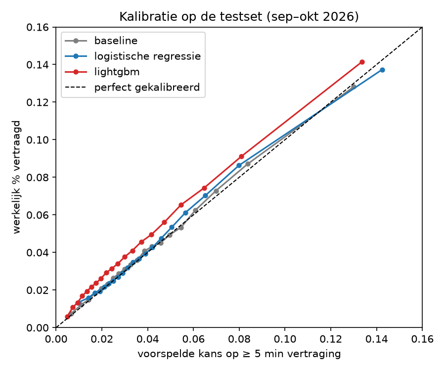
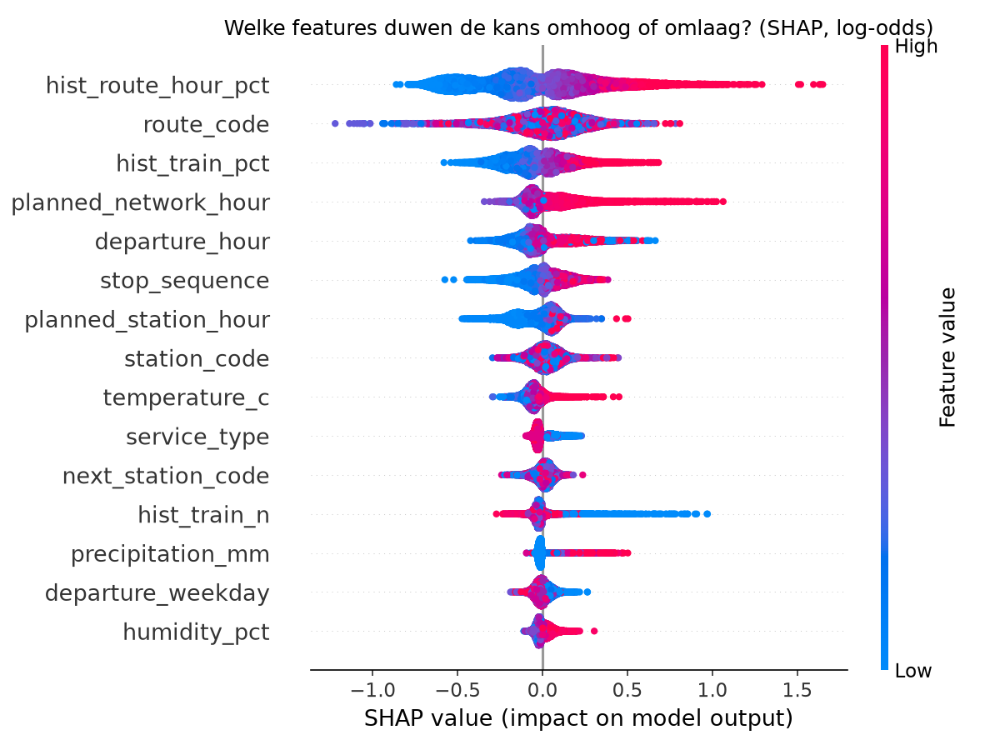

# Model: kans op ≥ 5 minuten vertraging

## 1. Probleemdefinitie

**Vraag:** *"Als deze trein rijdt, hoe groot is de kans dat hij met 5 minuten of meer vertraging vertrekt?"*

| | |
|---|---|
| **Eenheid** | Eén vertrek van een trein vanaf een station (`marts.fct_departures`). |
| **Target** | `is_delayed_5min` = vertrokken met ≥ 5 min vertraging. Geannuleerde vertrekken en onbekende vertragingen hebben geen target en doen niet mee (uitval is een apart cijfer, zoals NS dat rapporteert). |
| **Scope** | Binnenlandse treinen (Intercity, Intercity direct, Sprinter, Stoptrein, Sneltrein) vanaf een Nederlands station. Internationale treinen niet: hun vertraging ontstaat grotendeels buiten Nederland en buiten onze data. |
| **Voorspelmoment** | Een paar uur vóór vertrek. Het model mag dus alleen gebruiken wat dan bekend is: de dienstregeling, de kalender, de weersverwachting en de geschiedenis tot en met **gisteren**. |
| **Uitvoer** | Een kans tussen 0 en 1. Omdat maar ~4 % van de vertrekken vertraagd is, is een goed *gekalibreerde* kans nuttiger dan een ja/nee. |

## 2. Features

| Groep | Features | Bekend vooraf? |
|---|---|---|
| Rit | treintype, vervoerder, vertrekstation, volgend station, traject (`route_code`), positie in de rit (`stop_sequence`, `is_first_stop`) | ✅ dienstregeling (¹) |
| Tijd | uur, weekdag, maand, weekend | ✅ |
| Kalender | feestdag, aantal regio's met schoolvakantie (0–3) | ✅ |
| Drukte | aantal geplande vertrekken op dit station in dit uur, en landelijk in dit uur | ✅ dienstregeling |
| Weer | temperatuur, neerslag, gemiddelde wind, windstoten, zicht, luchtvochtigheid, sneeuw, mist, ijsvorming | ⚠️ in training de **gemeten** waarden; in productie een **verwachting** (²) |
| Geschiedenis | % vertraagd van dit traject × uur, van dit station, en van dit treinnummer — berekend over alle dagen **vóór** de vertrekdag | ✅ alleen verleden |

¹ `stop_sequence` telt ook stops mee die door een omleiding op de dag zelf zijn toegevoegd. Dat komt zelden voor (0,5 % van de ritten) en is als kleine onzuiverheid geaccepteerd.
² Een weersverwachting is minder precies dan een meting. De modelscores op de testset zijn daarom een **bovengrens** voor wat in productie haalbaar is.

## 3. Leakage voorkomen

*Leakage* = het model leert van informatie die het op het voorspelmoment niet kan weten, en lijkt daardoor beter dan het is.

**Verboden als feature** (afgedwongen door een test, [`tests/test_model_features.py`](../tests/test_model_features.py)):

- de vertraging zelf (`departure_delay_min`) en alles wat ervan is afgeleid;
- de vertraging van **dezelfde rit** op eerdere of latere stops (`arrival_delay_min`);
- `service_max_delay_min` en de annuleringsvelden van dezelfde rit (`is_cancelled`, `service_completely_cancelled`, `service_partly_cancelled`);
- perronwijzigingen (`platform_change`), datafout-vlaggen (`has_invalid_delay`);
- `agg_route_hour` uit de marts: die is over de **hele** periode berekend, dus ook over de toekomst. De historische features worden daarom opnieuw berekend met een venster dat stopt op de dag vóór vertrek (ook getest).

## 4. Train / validatie / test: split op tijd

| Set | Periode | Vertrekken | % vertraagd |
|---|---|---|---|
| Train | nov 2025 – jul 2026 | 12,9 mln | 4,1 % |
| Validatie | aug 2026 | 1,45 mln | 3,6 % |
| Test | sep – okt 2026 | 2,9 mln | 4,2 % |

**Nooit random splitten.** Bij een random split zit in de training een vertrek van 17:00 en in de test dezelfde trein van 17:00 op diezelfde stormachtige dag — het model "kent" dan de toekomst al. Met een split op tijd voorspellen we echt maanden die het model nooit heeft gezien, net als in productie.

**Geheugen:** de laptop heeft 8 GB werkgeheugen. Trainen gebeurt daarom op een willekeurige **steekproef binnen de trainingsperiode** (dat is geen leakage: alle rijen komen nog steeds uit het verleden); de evaluatie gebeurt op **alle** vertrekken van de testperiode.

## 5. Modellen

1. **Baseline** — het historische % vertraagd per traject × uur uit de trainingsperiode (met *smoothing*: weinig waarnemingen → dichter bij het landelijke gemiddelde). Elk slimmer model moet hier overheen.
2. **Logistische regressie** — lineair, goed uitlegbaar; categorische features one-hot, numerieke gestandaardiseerd.
3. **LightGBM** — gradient boosted trees met native categorische features; kleine hyperparameter-zoektocht op de validatieset, daarna opnieuw getraind op train + validatie.

## 6. Evaluatie (op de testset)

- **PR-AUC** (average precision) — de hoofdmaat: bij een zeldzame uitkomst (4 %) zegt die meer dan ROC-AUC.
- **ROC-AUC** — hoe goed rangschikt het model vertraagde boven niet-vertraagde vertrekken.
- **Brier-score** — gemiddelde kwadratische fout van de kans (lager is beter); samen met de **kalibratiecurve** laat dit zien of "10 % kans" ook echt 10 % betekent.
- Uitsplitsing per **treintype** en per **maand**, **SHAP**-samenvatting (welke features wegen het zwaarst) en een **foutanalyse**.

## 7. Resultaten

Reproduceren: `python -m ov_vertraging.model.train` (≈ 20 minuten rekentijd, piekgeheugen 6,7 GB). Alle runs staan in MLflow (`mlflow ui --backend-store-uri sqlite:///mlflow.db`); de volledige, automatisch gegenereerde tabellen in [`model_results.md`](model_results.md).

### Testset (sep–okt 2026, 2,9 mln vertrekken, 4,2 % vertraagd)

| Model | PR-AUC ↑ | ROC-AUC ↑ | Brier ↓ | Top 10 % riskantste vertrekken vangt … van alle vertragingen |
|---|---|---|---|---|
| Willekeurig gokken | 0,042 | 0,500 | — | 10 % |
| Baseline (historisch % traject × uur) | 0,092 | 0,683 | 0,0391 | 25,8 % |
| Logistische regressie | 0,100 | 0,678 | 0,0390 | — |
| **LightGBM** | **0,107** | **0,701** | **0,0389** | **27,9 %** |

Gekozen LightGBM: 255 bladeren, `min_child_samples` 1000, leersnelheid 0,05, 108 bomen (early stopping op augustus; PR-AUC validatie 0,096). Getraind op een steekproef van 2 mln vertrekken uit nov–jul plus heel augustus.

**Hoe lees je dit?**
- LightGBM vindt vertraagde treinen **2,5× zo goed als gokken** (PR-AUC 0,107 tegen 0,042) en ~16 % beter dan de simpele vuistregel.
- Concreet: in de 10 % vertrekken die het model het riskantst vindt, zit 28 % van alle vertragingen; van die vertrekken is 11,6 % daadwerkelijk vertraagd (tegen 4,2 % gemiddeld).
- Eerlijk: de winst op de baseline is bescheiden. Het grootste deel van wat voorspelbaar is, zit al in *"dit traject op dit uur was vaker te laat"*.

### Per treintype en maand

| | % vertraagd | PR-AUC | ROC-AUC |
|---|---|---|---|
| Sprinter | 3,7 % | 0,075 | 0,665 |
| Stoptrein | 2,8 % | 0,139 | 0,732 |
| Intercity | 6,2 % | 0,116 | 0,666 |
| Sneltrein | 6,3 % | 0,154 | 0,749 |
| Intercity direct | 8,8 % | 0,149 | 0,650 |
| september | 3,7 % | 0,098 | 0,702 |
| oktober | 4,6 % | 0,118 | 0,703 |

Regionale stoptreinen (andere vervoerders, vaste lijnen) zijn het best voorspelbaar; Sprinters het slechtst — hun vertraging komt vaak van ander treinverkeer op drukke hoofdlijnen.

### Kalibratie

Baseline en logistische regressie liggen op de diagonaal. LightGBM **onderschat** structureel: bij een voorspelde 4 % was het werkelijk ~4,8 %. Oorzaak: getraind t/m augustus (rustig, 3,6 %), getest in de herfst (4,2 %). Verbetering voor later: hercalibreren op de meest recente maand (bv. isotone regressie) of het seizoen sterker laten meewegen.

### Wat drijft de voorspelling? (SHAP)

1. **Geschiedenis** domineert: het historische % van traject × uur, het traject zelf en het historische % van het treinnummer.
2. **Drukte**: hoe meer treinen er landelijk in dat uur gepland staan, hoe hoger de kans.
3. **Uur en positie in de rit**: later op de dag en verder in de rit = meer opgebouwde vertraging.
4. **Weer**: temperatuur (warmte), neerslag en luchtvochtigheid duwen de kans omhoog, maar wegen minder dan de geschiedenis.
5. Opvallend: treinnummers met **weinig geschiedenis** (`hist_train_n` laag) hebben een hógere kans — dat zijn extra ritten en vervangende diensten.

### Foutanalyse: waar zit het model ernaast?

De dagen met de grootste onderschatting:

| Datum | Werkelijk | Voorspeld | Wat er gebeurde |
|---|---|---|---|
| 22–25 okt 2026 | 5,7–8,8 % | ~3 % | Storm (windstoten tot 10 Bft) en de nasleep ervan |
| 10 sep 2026 | 6,6 % | 3,6 % | De dag ná de landelijke OV-staking: materieel en personeel stonden niet op de goede plek |

Dit is de kern van de beperking: **storingen, stormschade en de nasleep van een staking zijn op het voorspelmoment niet bekend.** Het model voorspelt goed *welke* trajecten en uren structureel kwetsbaar zijn, maar ziet een slechte dag niet aankomen — zeker niet met gemeten in plaats van voorspeld weer als bovengrens. Mogelijke verbeteringen: weersverwachting met windstoten in de features (fase 5), het aantal lopende storingen op het netwerk als live feature, en hercalibratie.
